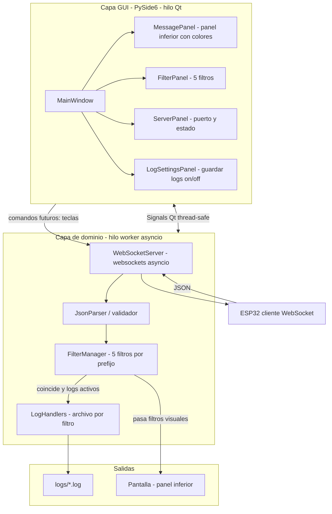
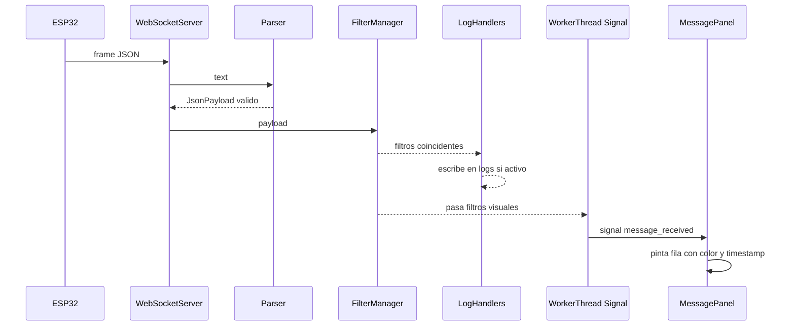

# Arquitectura y Estructura del Proyecto — i-mop-websocket

> **Regla:** la estructura de carpetas definida aquí es el mapa de trabajo. Todo módulo nuevo debe encajar en ella; si no encaja, primero se discute y se actualiza este documento.

## 1. Arquitectura general



Decisiones clave:

- **Red en hilo aparte**: asyncio corre en un worker thread; se comunica con Qt mediante señales (`Signal(dict)`), nunca tocando widgets desde otro hilo.
- **Dominio puro**: `FilterManager` y el parser son clases sin dependencias de Qt ni red → 100 % testeables.
- **Un solo flujo de datos**: todo mensaje entrante pasa por `parse → filter → (log + display)`.

## 2. Estructura de carpetas

```text
i-mop-websocket/
├── README.md
├── CHANGELOG.md                  # Historial de releases (Keep a Changelog)
├── pyproject.toml                # Metadatos, dependencias, tooling (PEP 621)
├── .gitignore
├── .pre-commit-config.yaml
├── imop.spec                     # Spec de PyInstaller (generada y versionada)
├── plans/                        # Plan de acción y registro IA
│   └── action-plan.md
├── docs/
│   ├── ARCHITECTURE.md
│   ├── CODING_STANDARDS.md
│   ├── DOCUMENTATION_RULES.md
│   ├── GIT_WORKFLOW.md
│   ├── BUILD_AND_DEPLOYMENT.md
│   └── user/                     # Documentación para usuarios finales
│       ├── manual.md
│       ├── faq.md
│       └── protocol.md
├── src/
│   └── imop/
│       ├── __init__.py           # __version__, logger raíz
│       ├── __main__.py           # python -m imop
│       ├── app.py                # Punto de entrada: QApplication + bootstrap
│       ├── cli.py                # argparse: --port, --log-dir, --no-gui (futuro)
│       ├── config.py             # Carga/guardado de configuración (JSON, escritura atómica)
│       ├── constants.py          # DEFAULT_PORT, MAX_FILTERS = 5, colores por tipo
│       ├── theme.py              # Color estable por clave raíz (módulo puro, sin Qt)
│       ├── core/                 # Dominio puro (sin Qt, sin red)
│       │   ├── models.py         # JsonPayload, FilterRule, DisplayMessage, ServerStatus
│       │   ├── parser.py         # Validación y normalización de JSON
│       │   ├── filters.py        # FilterManager: matching por prefijo
│       │   └── pipeline.py       # MessagePipeline: parseo → filtros → logs → display
│       ├── network/
│       │   ├── server.py         # WebSocketServer (asyncio + websockets)
│       │   └── client_registry.py# Clientes conectados + broadcast (base del envío futuro)
│       ├── logging_service/      # (no "logging": evita ambigüedad con el stdlib)
│       │   └── handlers.py       # FilterLogManager: RotatingFileHandler por filtro
│       └── gui/
│           ├── main_window.py    # MainWindow
│           ├── panels/
│           │   ├── server_panel.py
│           │   ├── message_panel.py
│           │   ├── filter_panel.py
│           │   └── log_settings_panel.py
│           ├── workers.py        # WorkerThread: puente asyncio <-> Qt signals
│           ├── theme.py          # Paleta de colores por tipo de mensaje
│           └── resources/        # Iconos, logos
├── tests/
│   ├── conftest.py
│   ├── unit/                     # core/filters, core/parser, config
│   ├── network/                  # servidor con cliente mock (websockets test utils)
│   └── gui/                      # smoke tests con pytest-qt
└── scripts/
    ├── build_windows.bat         # PyInstaller -> dist/Imop.exe
    ├── build_linux.sh
    └── build_macos.sh
```

Notas de estructura:

- Layout **`src/`**: evita importar el paquete sin instalarlo; obliga a probar la versión instalada (`pip install -e .`).
- `imop/core/` **no importa** `PySide6` ni `websockets` → pruebas unitarias rápidas y puras.
- El nombre del ejecutable y del paquete: `imop` / `Imop.exe`.

## 3. Entornos virtuales por plataforma

Un único `pyproject.toml`; el venv se crea localmente en cada sistema:

| SO | Comando de creación | Activación |
|----|--------------------|------------|
| Windows | `python -m venv .venv` | `.venv\Scripts\activate` |
| Linux | `python3 -m venv .venv` | `source .venv/bin/activate` |
| macOS | `python3 -m venv .venv` | `source .venv/bin/activate` |

Instalación (idéntica en los 3 SO): `pip install -e .[dev]`.

> **Alternativa recomendada:** usar [`uv`](https://docs.astral.sh/uv/) (`uv sync`) — más rápido y con lockfile reproducible (`uv.lock` versionado). Decisión final en Fase 1.

### Dependencias previstas

| Paquete | Rol |
|---------|-----|
| `PySide6` | GUI |
| `websockets` | Servidor WebSocket asyncio |
| `pyinstaller` *(dev)* | Empaquetado |
| `pytest`, `pytest-qt`, `pytest-asyncio`, `ruff`, `mypy`, `pre-commit` *(dev)* | Calidad |

## 4. Flujo de un mensaje (secuencia)



### 4.1 Protocolo de confirmación (ACK por `seq`)

Si el mensaje del cliente incluye un campo `"seq"` **entero**, el servidor responde
en la misma conexión después de procesarlo:

| Mensaje del cliente | Respuesta del servidor |
|---------------------|------------------------|
| `{"seq": 7, "sensor_temp": {"value": 23.4}}` | `{"ack_seq": 7, "status": "ok"}` |
| `{"seq": 8, ...}` con fallo interno del callback | `{"ack_seq": 8, "status": "error"}` |
| Mensaje sin `seq`, o con `seq` no entero | *(sin respuesta — retrocompatible)* |
| Frame no parseable como JSON | *(sin respuesta — se muestra como ERROR en la GUI)* |

Implementación: [`network/server.py`](../src/imop/network/server.py) (`_extract_seq` / `_send_ack`).
El ESP32 puede usar el `status` del ACK para retransmitir mensajes perdidos.

## 5. Configuración persistente

- Ubicación: perfil de usuario (portable-friendly) — `QSettings("imop", "i-mop-websocket")` o `~/.imop/config.json`.
- Contenido: puerto, 5 filtros (nombre + habilitado), carpeta de logs, flag "guardar logs", atajos de teclas (futuro).
- Escritura atómica (temporal + rename) para evitar corrupción.

## 6. Estrategia de pruebas

| Capa | Herramienta | Qué se prueba |
|------|-------------|---------------|
| `core/` | pytest unitario | Prefijos, JSON inválido, mayúsculas/minúsculas, payload vacío |
| `network/` | pytest-asyncio + cliente mock | Conexión, desconexión, mensajes malformados, múltiples clientes |
| `gui/` | pytest-qt | Panel recibe señal, filtros aplican en pantalla, límite de filas |
| E2E manual | ESP32 / `wscat` | Checklist por release |

## 7. Extensibilidad futura (envío de teclas)

- `ClientRegistry` ya contempla múltiples clientes: el panel de teclas futuras solo necesita `registry.send_all(json)`.
- Los atajos se definirán en configuración como pares *(tecla → JSON)*, renderizados como botones configurables.
- El protocolo de envío se documentará en `docs/user/protocol.md` (Fase 5).
