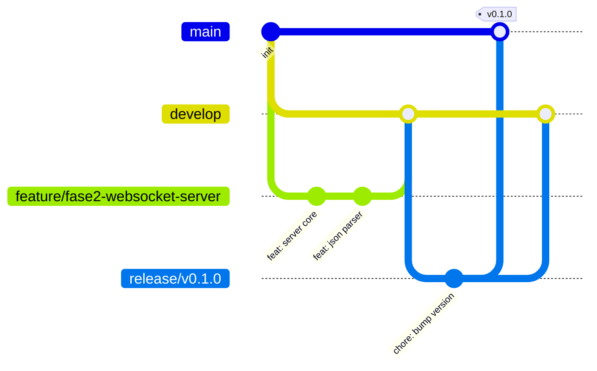
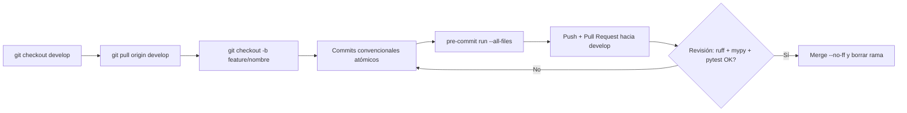

# Flujo Git Profesional — i-mop-websocket

> **Regla:** la rama `main` siempre debe estar publicable (ejecutable/compilable). Nada se commitea directamente a `main` ni a `develop`.

## 1. Modelo de ramas — GitFlow



| Rama | Origen | Destino | Propósito | Protegida |
|------|--------|---------|-----------|-----------|
| `main` | — | — | Código en producción, cada commit es un release con tag | ✅ |
| `develop` | `main` | — | Integración continua del desarrollo | ✅ |
| `feature/<nombre>` | `develop` | `develop` | Nueva funcionalidad (fases, módulos) | ❌ |
| `bugfix/<nombre>` | `develop` | `develop` | Correcciones en desarrollo | ❌ |
| `release/vX.Y.Z` | `develop` | `main` + `develop` | Preparación de versión: bump, CHANGELOG, QA | ❌ |
| `hotfix/<nombre>` | `main` | `main` + `develop` | Corrección urgente en producción | ❌ |

## 2. Nomenclatura

- `feature/websocket-server`, `feature/gui-filtros`, `feature/envio-teclas`
- `bugfix/puerto-ocupado-al-reiniciar`
- `hotfix/v0.1.1-crash-json-invalido`
- `release/v0.2.0`
- Minúsculas, español o inglés consistente, sin espacios.

## 3. Commits convencionales (Conventional Commits)

Formato: `tipo(alcance): descripción breve en imperativo`

```
feat(server): agregar soporte de múltiples clientes conectados
fix(gui): evitar freeze del panel al recibir mensajes a alta frecuencia
docs(user): agregar sección de filtros al manual
refactor(filters): extraer FilterManager a su propio módulo
test(filters): cubrir prefijos vacíos y claves raíz anidadas
chore(build): actualizar spec de PyInstaller para PySide6
```

Tipos válidos: `feat`, `fix`, `docs`, `style`, `refactor`, `perf`, `test`, `build`, `ci`, `chore`, `revert`.

- Descripción ≤ 72 caracteres, minúscula inicial, sin punto final.
- El cuerpo (opcional) explica el **porqué**.

## 4. Versionado semántico (SemVer)

`vMAYOR.MINOR.PARCHE`

- **MAYOR**: cambios incompatibles (formato de config, protocolo de logs).
- **MINOR**: nuevas features (p. ej. envío de teclas al ESP32).
- **PARCHE**: fixes sin cambios de interfaz.

Tags: `git tag -a v0.1.0 -m "Primer release con servidor y visualizador"`. Cada tag en `main` dispara el build del ejecutable (cuando exista CI).

## 5. Flujo de trabajo por tarea



### Reglas de Pull Request

- Título en formato commit convencional.
- Descripción: qué, por qué, cómo probarlo, capturas si toca la UI.
- Mínimo 1 revisión aprobatoria antes de merge (auto-revisión permitida mientras no haya equipo).
- Merge con `--no-ff` para preservar historia de la feature.
- Actualizar [`plans/action-plan.md`](../plans/action-plan.md) en el mismo PR.

## 6. Releases (rama `release/`)

1. Crear `release/vX.Y.Z` desde `develop`.
2. Actualizar versión (`imop/__version__`), `CHANGELOG.md` (Keep a Changelog), manual de usuario si aplica.
3. QA: ejecutar la app, probar filtros, logs, guardado; ejecutar suite de tests.
4. Mergear a `main` (merge commit) y de vuelta a `develop`.
5. Taguear en `main`: `vX.Y.Z`.
6. Crear **GitHub Release** adjuntando el `.exe` y binarios generados.

## 7. Configuración inicial del repositorio (Fase 1)

```bash
git init
git checkout -b main
git add README.md docs/ plans/
git commit -m "docs: agregar reglas de diseño, arquitectura y plan de acción"
git checkout -b develop
git push -u origin main develop
```

Proteger en GitHub: `main` y `develop` (sin push directo, PR obligatorio). Agregar `.gitignore` de Python (`.venv/`, `__pycache__/`, `build/`, `dist/`, `*.spec.bak`, `logs/`, `.pytest_cache/`, `.mypy_cache/`, `.ruff_cache/`).

## 8. Buenas prácticas adicionales

- **Atomicidad**: un commit = un cambio lógico (nunca mezclar `feat` y `fix`).
- **Nunca** reescribir historia en `main`/`develop`; solo en ramas propias antes del PR.
- **No commitear secretos** ni rutas locales; usar variables de entorno.
- **Logs y artefactos de build** (`logs/`, `dist/`, `build/`) nunca al repositorio.
- Firma de commits (`git commit -s` o GPG) recomendada para trazabilidad.
- CI (futuro, GitHub Actions): lint + mypy + pytest en cada PR; build de release en cada tag.
